<div align="center">


# HypoSense Twin

**An exposure-aware digital twin for early warning of low glucose**

HypoSense Twin keeps a continuously updated picture of each patient. The picture combines
continuous glucose monitor (CGM) readings, recorded medication and patient context. At every
new reading, the twin estimates the risk that a **CGM-detected low-glucose episode will begin
within the next 60 minutes**. Fixed, auditable rules then turn that estimate into a status a
ward team can review.


[Product tour](#product-tour) ·
[Quick start](#quick-start) ·
[Guided demo](#try-the-guided-demo) ·
[How it works](#how-it-works) ·
[Evidence](#development-results) ·
[Limitations](#limitations-safety-and-ethics)

</div>

> [!IMPORTANT]
> **Research and decision-support prototype.**
> - Not a medical device, and not clinically validated.
> - It never recommends, adjusts or simulates doses or treatment. The only action it supports is
>   human review and capillary glucose confirmation.
> - Every number in this repository is a **development** result. The pre-registered
>   confirmatory evaluation on the sealed patient partition has **not been run yet** (see
>   [Project status](#project-status)).

## Digital Twin Challenge 2026 - Team Information

**Project Title:** HypoSense Twin  
**Registered Team Name:** 2006yugb  
**Competition:** Digital Twin Challenge 2026  
**Organizer:** Happiest Health  
**Institution:** Indian Institute of Technology Kharagpur (IIT Kharagpur), India

### Team Members

| Name | Role |
|---|---|
| Yug Birla | Team Leader |
| Smriti Tubid | Team Member |

### About Our Project

HypoSense Twin is an exposure-aware digital twin designed to predict CGM-detected hypoglycaemic episodes in adults with Type 2 Diabetes.

It integrates historical patient context, continuous glucose monitoring (CGM) readings, meals, and recorded medication information into a continuously updated patient state. Using LightGBM and time-resolved medication exposure features, the system estimates the risk of a new low-glucose episode within the next 60 minutes.

The prototype also includes a clinician-facing dashboard for reviewing patient states, predictions, medication exposure estimates, explanations, and recorded alert outcomes.

**Project Status:** Working research prototype. Confirmatory evaluation pending. Not clinically validated or intended for autonomous medical decision-making.

<p align="center">
  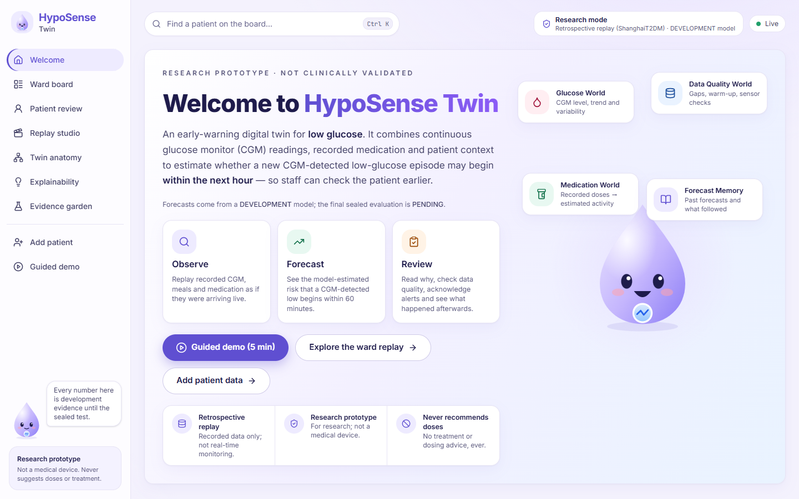
</p>

---

## Contents

| Understand | Run | Examine |
|---|---|---|
| [At a glance](#at-a-glance) | [Quick start](#quick-start) | [Scientific evaluation](#scientific-evaluation) |
| [Why HypoSense?](#why-hyposense) | [Try the guided demo](#try-the-guided-demo) | [Development results](#development-results) |
| [What makes it different](#what-makes-it-different) | [Bring your own data](#bring-your-own-data) | [Reproducibility](#reproducibility) |
| [Product tour](#product-tour) | [Testing and quality](#testing-and-quality) | [Limitations, safety and ethics](#limitations-safety-and-ethics) |
| [How it works](#how-it-works) | [Technology stack](#technology-stack) | [Project status](#project-status) |
| [The four worlds of the twin](#the-four-worlds-of-the-twin) | [Project structure](#project-structure) | [Data, licence and citation](#data-licence-and-citation) |
| [Prediction task and states](#prediction-task-and-states) · [Model ladder](#model-ladder) | | [Documentation map](#documentation-map) |

---

## At a glance

| | |
|---|---|
| **What it predicts** | The start of a new CGM-detected Level 1 low (< 70 mg/dL) within the next 60 minutes. A useful warning comes at least 15 minutes before the start |
| **For whom** | Adults with type 2 diabetes treated with insulin or insulin secretagogues (development data: ShanghaiT2DM) |
| **What it shows** | LOW NOW (observed), ALERT · WATCH · NO ALERT (predicted), INSUFFICIENT DATA, SYSTEM ERROR |
| **Core idea** | Recorded doses become **time-resolved estimates of how much medicine may still be active** (medication exposure), next to CGM, meals and context |
| **Research question** | Does medication exposure (M3) warn of more lows than a strong CGM + context model (M2) at the same false-alert burden of 1 per patient-day? |
| **How it runs** | Locally and offline on a CPU: a FastAPI backend that serves a Next.js frontend. No cloud service and no LLM |
| **Data paths** | Historical replay of recorded patients, **or** new patients you upload or type in. New data are never used for training or as evidence |
| **Status** | Development complete and verified. Confirmatory evaluation **pending** two human approvals |

## Why HypoSense?

**The problem.**
- Hypoglycaemia is a common and dangerous side effect of insulin and sulfonylurea therapy.
- On a ward, glucose is often checked on a timetable, so an episode can begin between checks.
- A CGM shows where glucose *is now*.
- Insulin and secretagogues keep acting for hours after they are given. Glucose history alone
  may therefore miss part of what drives the next hour.

**The question.** HypoSense was built to answer one pre-registered question:

> *Can an explicit, time-resolved representation of recorded medication exposure improve
> timely detection of future CGM-detected low-glucose episodes, at the same false-alert
> burden, beyond a strong CGM-plus-context model?*

**The approach.** A **stateful, feature-based digital twin**, not a physiological simulator.
For each patient, the twin:
1. **observes** CGM, meals, recorded doses and context, strictly in time order;
2. **estimates** medicine activity from documented, label-sourced pharmacological kernels;
3. **predicts** the 60-minute risk with a calibrated gradient-boosted model;
4. **decides** a status with a deterministic, separately tested policy;
5. **remembers** every forecast and later checks it against what the CGM actually showed.

We make no claim of clinical benefit. The confirmatory test that would answer the question has
not been run yet.

## What makes it different

| Differentiator | What it means here | Where it is verified |
|---|---|---|
| **Medication-aware state** | Each recorded dose becomes an estimated activity curve over time, not a "prescribed: yes/no" flag. Overlapping doses add up. Unknown timing stays unknown | Kernel unit tests; `configs/pharma.yaml` (per-parameter source); [PARAMETER_SOURCES](docs/medication/PARAMETER_SOURCES.md) |
| **Causal by construction** | Features at time *t* use only information available at or before *t* | **Truncation-equality test**: 31,292 prediction times, 0 mismatches. Future-perturbation test: 0 / 1,200 |
| **One pipeline, offline = live** | Training, replay and new-data sessions run through the same parser, state engine and feature builder | Parity: 133,856 feature comparisons, 0 mismatches |
| **Model ≠ policy** | The model outputs a probability. A separate deterministic policy decides the status (thresholds, 60-min cooldown, data-sufficiency rules) | Policy unit tests for boundaries, cooldown, recovery, missing data and malformed input |
| **"No information" ≠ "low risk"** | Too little recent CGM, a gap, warm-up or a sensor fault give INSUFFICIENT DATA, never a falsely reassuring NO ALERT | Policy tests; shown in the UI |
| **Forecast memory** | Every forecast is later scored against the CGM, including false and missed alerts. Earlier forecasts are never rewritten | Outcome-ledger tests |
| **Deterministic replay** | The same recordings always give the same decision log (hash-identical) | Reproducibility tests |
| **Bring your own data** | CSV/XLSX upload or manual entry, with deterministic clarification questions. No retraining | `tests/integration/test_intake.py`. A real recording uploaded as CSV gives identical events, decisions and probabilities |
| **Pre-registered evidence** | Patient-level sealed partition, a fixed false-alert budget, a paired patient-cluster bootstrap and a fail-closed freeze | [ANALYSIS_PLAN](docs/protocol/ANALYSIS_PLAN.md); `hyposense freeze` |

These are engineering and methodological properties. None of them is a proven clinical
advantage.

## Product tour

All screenshots below come from the running application. Patient screens show **SYNTHETIC**
new-data sessions only (labelled "SYNTHETIC-…" and "NEW DATA SESSION"); the evidence screens
show aggregate development statistics. The script that produced them is
[scripts/ui_readme_showcase.py](scripts/ui_readme_showcase.py).

<table>
<tr>
<td width="50%" valign="top">
<b>Ward board: who needs attention now?</b><br/>
Patients ordered by status and then by risk, with latest glucose, a 2-hour sparkline, the
60-minute risk, a plain reason and data freshness.<br/><br/>
<a href="docs/screenshots/readme/ward.png">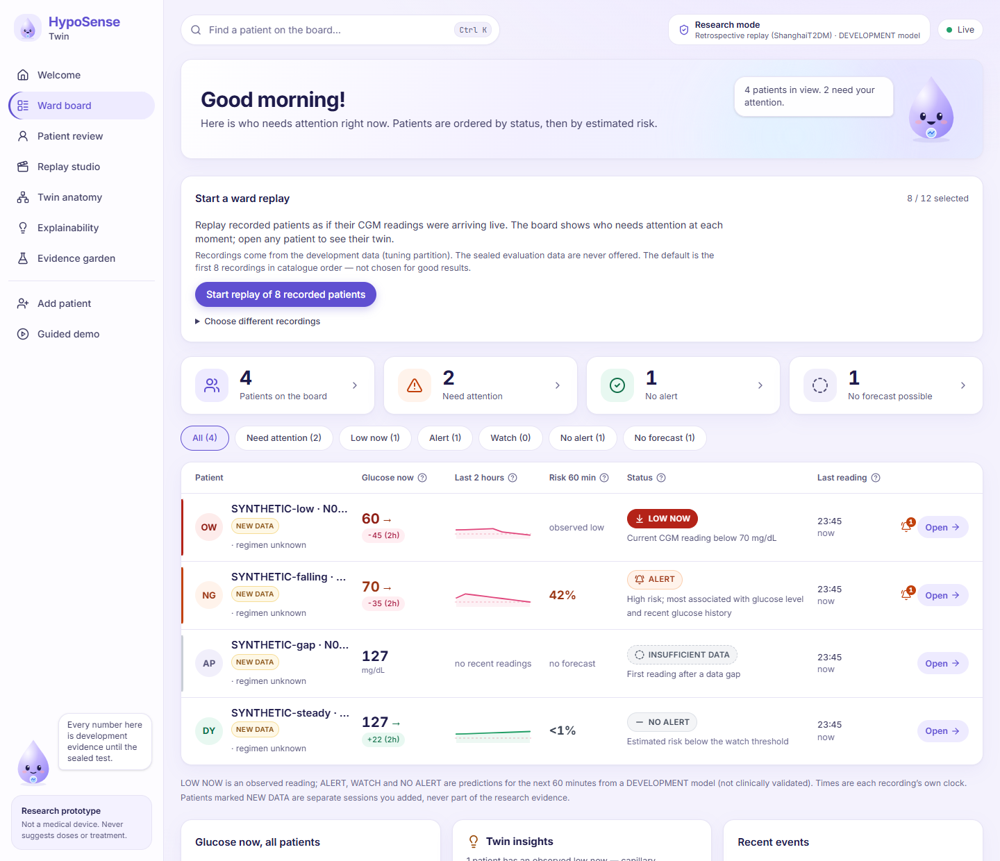</a>
</td>
<td width="50%" valign="top">
<b>Patient review: observed vs predicted</b><br/>
A 24-hour glucose and risk timeline. The status rail keeps <i>Observed now</i> apart from
<i>Predicted · next 60 min</i>, which reads "This is a forecast, not a low".<br/><br/>
<a href="docs/screenshots/readme/patient_overview.png">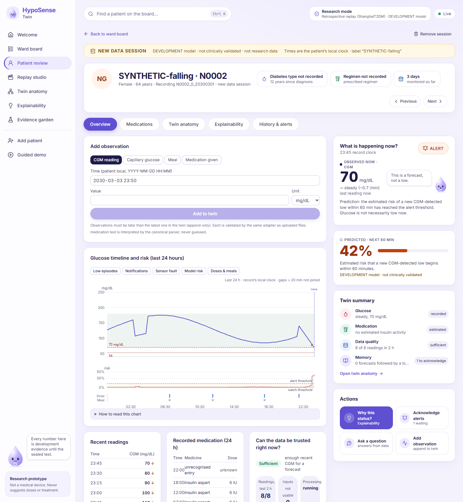</a>
</td>
</tr>
<tr>
<td width="50%" valign="top">
<b>Twin anatomy: inside the twin</b><br/>
The four state blocks (Glucose, Medication, Data Quality, Memory), showing the values the
model actually receives.<br/><br/>
<a href="docs/screenshots/readme/twin_anatomy.png">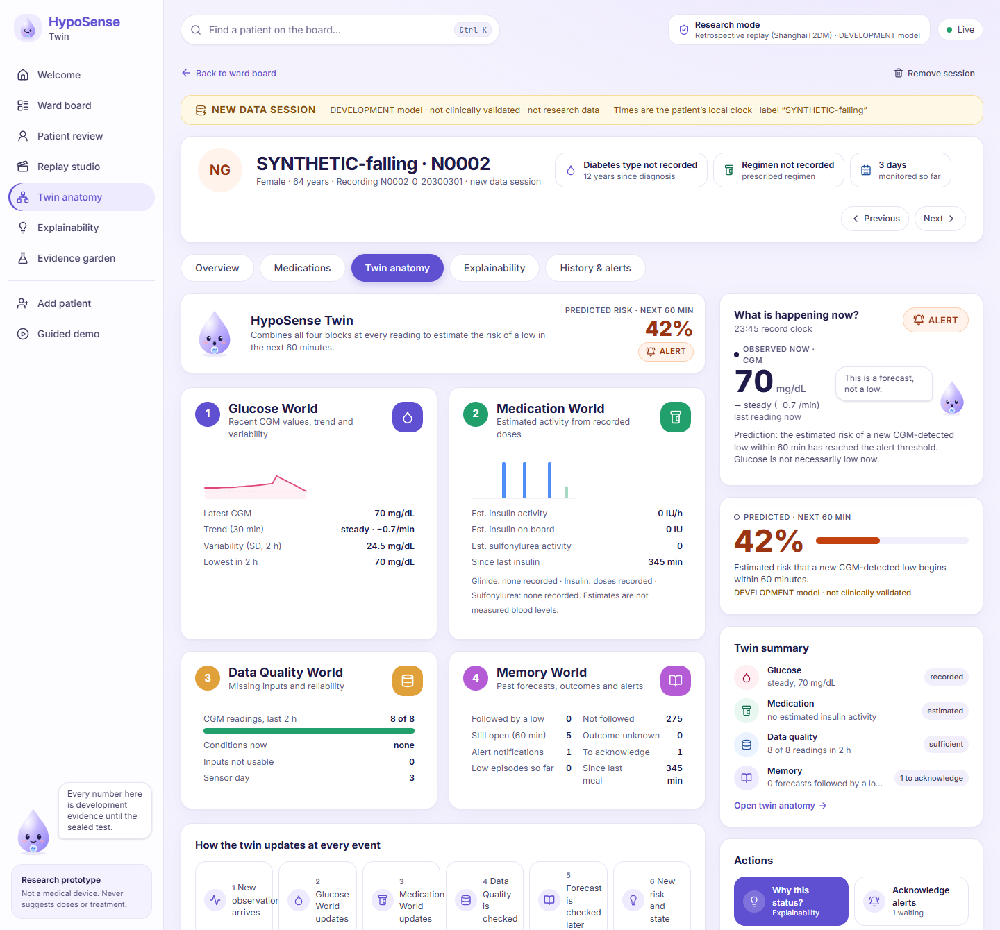</a>
</td>
<td width="50%" valign="top">
<b>Explainability: why is the twin worried?</b><br/>
A plain reason, then the information groups that push the estimate up or down (grouped
TreeSHAP; associations, not causes).<br/><br/>
<a href="docs/screenshots/readme/explainability.png">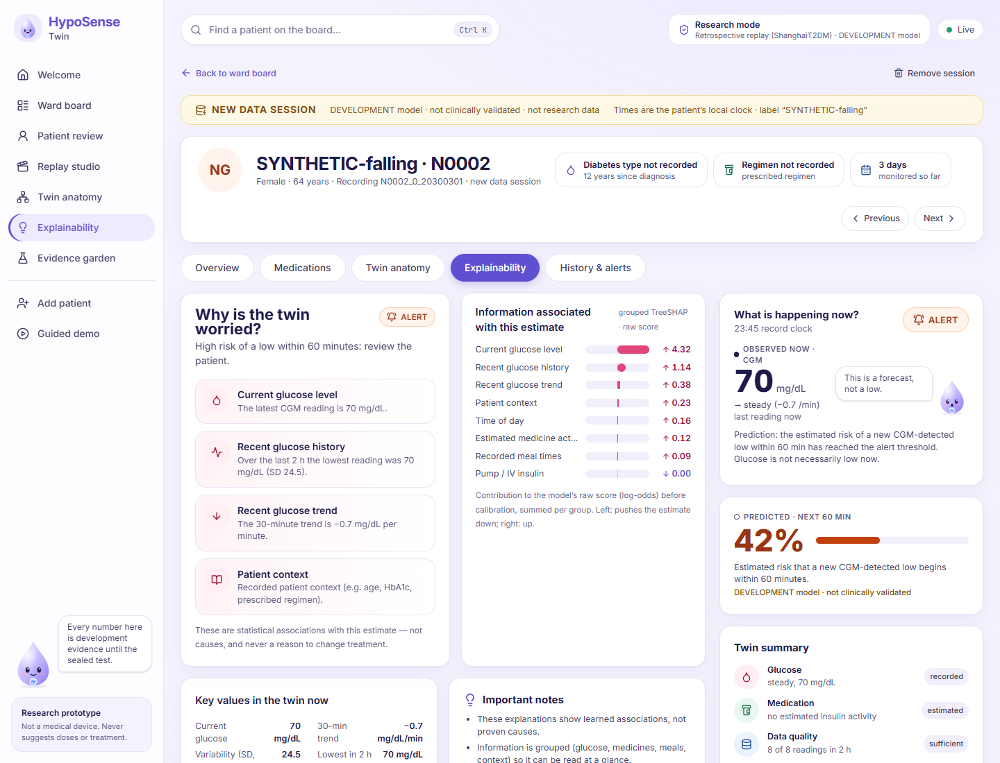</a>
</td>
</tr>
<tr>
<td width="50%" valign="top">
<b>Medications: recorded vs estimated</b><br/>
Bars are doses as recorded. Curves are the model's estimate of remaining activity, never a
measured blood level.<br/><br/>
<a href="docs/screenshots/readme/patient_medications.png">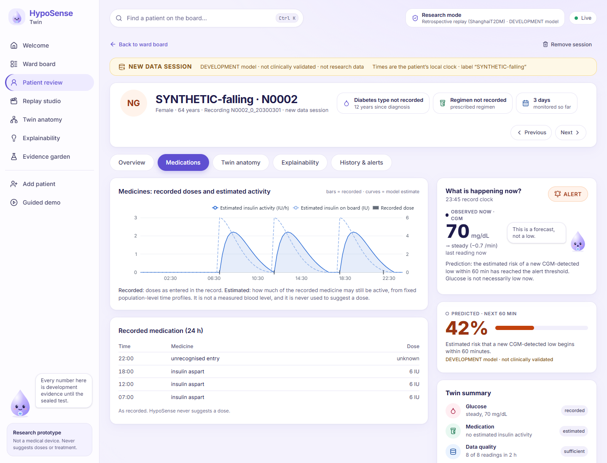</a>
</td>
<td width="50%" valign="top">
<b>Evidence garden: how was it tested?</b><br/>
The model ladder, operating curves, paired confidence intervals, calibration, safeguards and
provenance, with every result marked DEVELOPMENT.<br/><br/>
<a href="docs/screenshots/readme/evidence_models.png">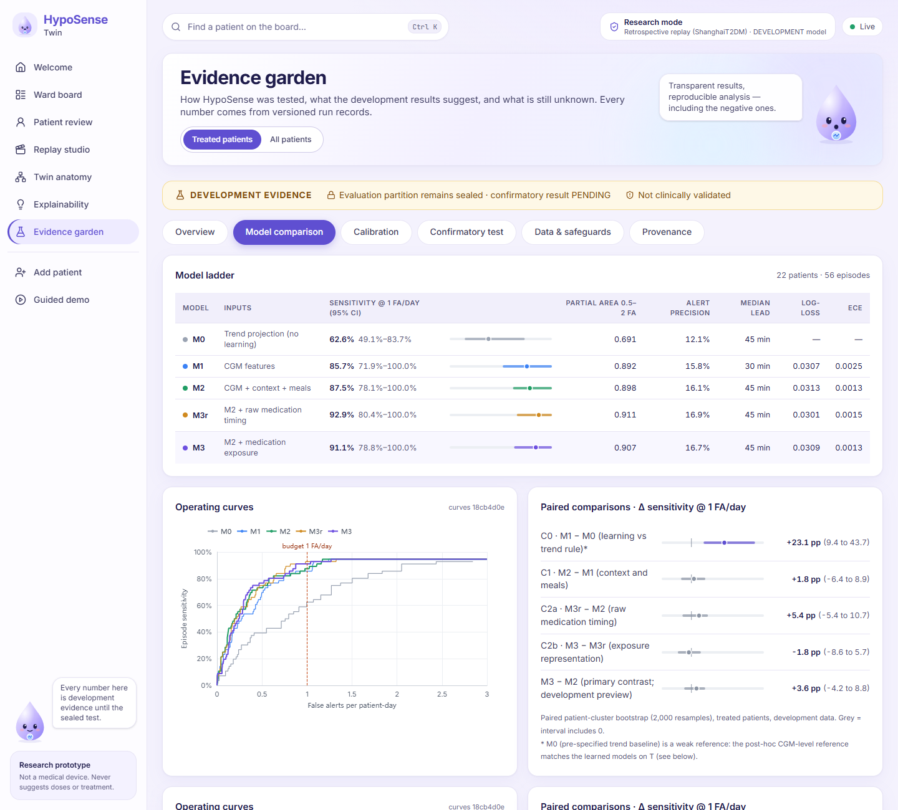</a>
</td>
</tr>
<tr>
<td width="50%" valign="top">
<b>Add patient: questions only when the data need them</b><br/>
Upload a CSV/XLSX file. Each question explains why it is asked and what happens if you
cannot answer it.<br/><br/>
<a href="docs/screenshots/intake/02_questions_blocked.png">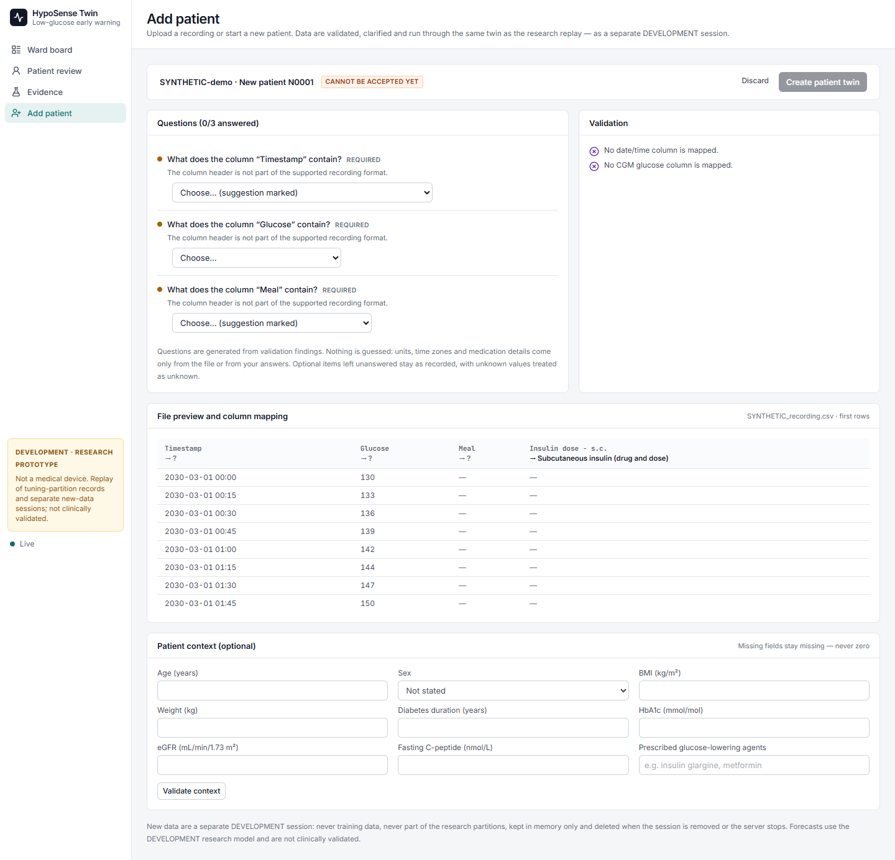</a>
</td>
<td width="50%" valign="top">
<b>Guided demo: a 5-minute tour on real replay</b><br/>
Eight steps that drive the real replay, including the first alert and what happened after it,
whichever way it turned out.<br/><br/>
<a href="docs/screenshots/readme/guided_demo.png">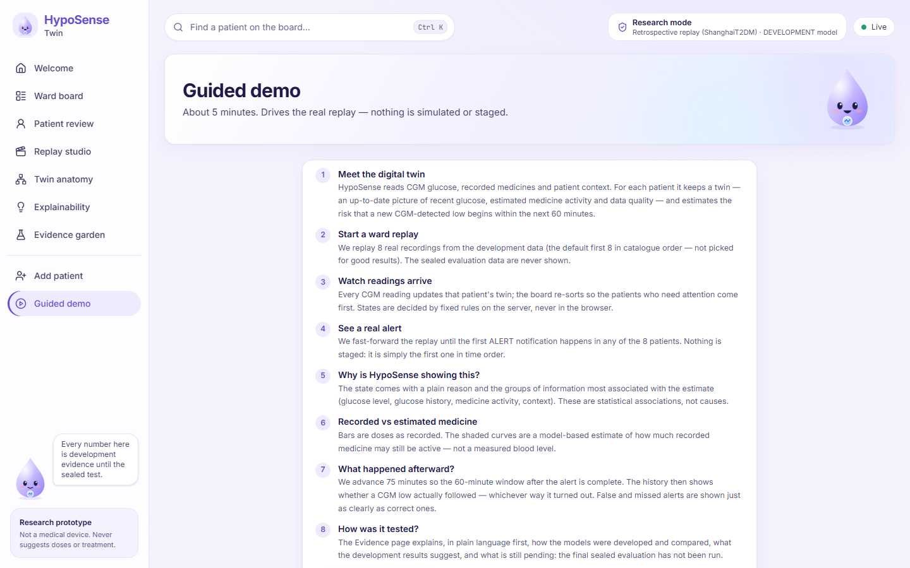</a>
</td>
</tr>
</table>

More: the [Evidence overview](docs/screenshots/readme/evidence_overview.png) and
[a refused out-of-order observation](docs/screenshots/intake/06_observation_refused_out_of_order.png).

## Quick start

> [!NOTE]
> The patient dataset is **not** in this repository (CC BY 4.0, fetched from the official
> record and verified by SHA-256). The server will not start until the data step below has been
> run once. A fresh clone without the data stops with `data root not found`.

**Prerequisites:**
- Python 3.11 and [uv](https://docs.astral.sh/uv/getting-started/installation/);
- Node.js 20.9 or newer with npm;
- about 1 GB of free disk space;
- internet access once, for the packages and the dataset.

```bash
git clone https://github.com/yug-birla/HypoSense-Twin.git
cd HypoSense-Twin

uv sync                                            # Python environment from uv.lock
cd frontend && npm ci && npm run build && cd ..    # static frontend → frontend/out

uv run hyposense data fetch                        # official ShanghaiT2DM v5 from figshare (MD5 + SHA-256 checked)
uv run hyposense data extract                      # allow-listed extraction → data/raw/ShanghaiT2DM
uv run hyposense data manifest                     # verify every file against data/MANIFEST.json

uv run hyposense serve --port 8765                 # → http://127.0.0.1:8765
```

Open **http://127.0.0.1:8765** and stop the server with `Ctrl+C`. Without `--port`, the server
listens on port 8000.

**What happens at start-up:**
- The server verifies the committed development model (`artifacts/models/M3-candidate-*`)
  against its manifest and refuses to start on any mismatch.
- It loads only the **tuning partition (T)** recordings. Sealed evaluation patients are never
  offered.
- No GPU, no account and no network connection are needed after setup.

**Verified** on Windows 11 (Git Bash) from a fresh clone of this repository. The
commands are the same on macOS and Linux, but those platforms have not been tested.

## Try the guided demo

About 5 minutes. Everything runs on recorded replay data; nothing is staged.

1. Start the server and open **Welcome** → **Guided demo (5 min)**.
2. **Meet the digital twin.** What the twin observes and estimates.
3. **Start a ward replay.** Eight development recordings, the first 8 in catalogue order (not
   chosen for good results).
4. **Watch readings arrive.** Advance 2 hours; the Ward board re-sorts as each twin updates.
5. **See a real alert.** Fast-forward to the first ALERT in time order.
6. **Why is HypoSense showing this?** Compare *Observed now* with *Predicted · next 60 min*,
   then open *Explainability*.
7. **Recorded vs estimated medicine.** Doses as bars, estimated activity as curves.
8. **What happened afterward?** Advance 75 minutes so the 60-minute window closes, and read the
   outcome in *History & alerts*.
9. **How was it tested?** Open the *Evidence garden*.

> [!TIP]
> **A false alert is part of the demo, on purpose.** With the default recordings, the first
> alert is **not** followed by a CGM low. The demo says so instead of choosing a flattering
> example. Every early-warning system trades lows caught against false alerts, and HypoSense
> records and measures both.

A timed presenter script is in [docs/submission/DEMO_GUIDE.md](docs/submission/DEMO_GUIDE.md).

## Bring your own data

**Add patient** builds a live twin from new data with the **same** parser, state engine,
model, calibration and policy. Nothing is retrained.

| | |
|---|---|
| **Formats** | CSV (UTF-8) or XLSX (one worksheet), with a header row. Limits: 5 MB, 100,000 rows, 40 columns |
| **Required** | A date/time column and a CGM column |
| **Optional** | Capillary glucose, meals, subcutaneous / i.v. / pump insulin, other glucose-lowering agents, ketones; context (age, sex, BMI, weight, diabetes duration, HbA1c, eGFR, C-peptide, prescribed agents) |
| **Recognised headers** | The dataset's own headers are mapped automatically, for example `Date`, `CGM (mg / dl)`, `CBG (mg / dl)`, `Dietary intake`, `Insulin dose - s.c.` |
| **Units and time** | mg/dL or mmol/L, as stated by you and never inferred from magnitudes. Patient-local clock or UTC with a stated offset. Mixed time zones are refused |
| **Unknown values** | Stay unknown. They are never set to zero or guessed |
| **Without a file** | *Start new patient*, then add CGM, capillary glucose, meals and doses one at a time, strictly in time order (append-only) |
| **Example** | [SYNTHETIC_recording.csv](docs/screenshots/intake/SYNTHETIC_recording.csv), a 3-day SYNTHETIC recording, generated by the same fixture the browser E2E test uploads |

**Clarification questions** are deterministic and appear only when a validation finding
requires them. They cover column meaning, glucose unit, clock or UTC offset, pump insulin type,
and medication entries the canonical parser cannot read. Each question shows *Why we ask* and
*If you can't answer*.

**Ask about this patient** offers nine fixed questions. Examples: why this status, are the
readings current, what changed, what happened after the last alert, which medicines are
recorded, what is missing. Answers come only from the twin's recorded state. There is no free
text, no chatbot and no LLM.

**Privacy and retention:**
- Uploads are held **in memory only** and never written to disk.
- Identifiers are pseudonymous (`N0001`). A display label is optional, limited to 24 characters,
  and should never be a name.
- *Remove session* deletes the session and its decision log. Stopping the server discards all
  sessions.
- New data never enter the research partitions, training, calibration or evidence.
- Forecasts on uploaded data carry **no accuracy claim**.

Details: [docs/INTAKE.md](docs/INTAKE.md).

## How it works

### Runtime: one path for replay and new data

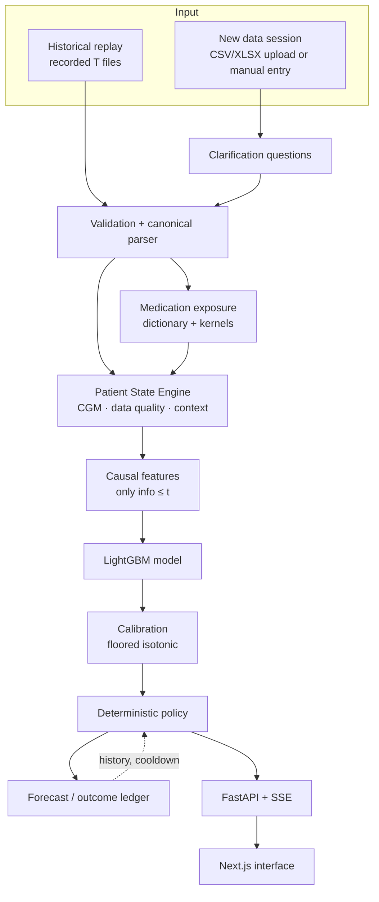

| Component | Receives | Does | Produces |
|---|---|---|---|
| **Validation + parser** (`data/loader`, `intake/`) | Recorded files, uploads, manual entries | Checks units, timestamps, duplicates and quality flags with one canonical adapter. Nothing is silently dropped | Ordered, typed events |
| **Medication exposure** (`medication/`) | Raw medication text with time and dose | Normalises the name, maps it to a class and formulation, and applies a pharmacological kernel. Malformed or ambiguous entries are flagged, never guessed | Estimated activity per drug class over time, with quality flags |
| **Patient State Engine** (`state/`) | Events in time order | Updates CGM history, data quality, exposure, context and the ledger, deterministically and replayably | `PatientState` |
| **Causal feature builder** (`features/`) | `PatientState` at time *t* | Computes the versioned feature set for the chosen model | `FeatureSnapshot` |
| **Model + calibration** (`models/`, `calibration/`) | Features | LightGBM score, mapped to a probability | Calibrated 60-minute risk |
| **Policy** (`policy/`) | Risk, current reading, data sufficiency, alert history | Applies the frozen thresholds, the 60-minute cooldown and data-sufficiency rules | Status, notification, reason codes and plain texts |
| **Forecast / outcome ledger** (`state/ledger`) | Every decision | Scores each forecast against the next 60 minutes of CGM once they exist | TRUE / FALSE / pending / unknown outcomes |
| **API + UI** (`api/`, `frontend/`) | Service state | REST + server-sent events; the UI displays results and contains **no** scientific logic | Ward board, patient review, evidence, intake |

### Offline research pipeline (separate from the runtime)

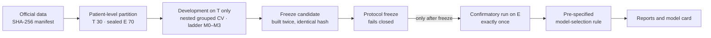

More detail: [docs/ARCHITECTURE.md](docs/ARCHITECTURE.md) and [docs/FRONTEND.md](docs/FRONTEND.md).

## The four worlds of the twin

The *Twin anatomy* tab groups the twin's state into four **conceptual worlds**. They are
views over one Patient State Engine and one model, not four separate models.

| World | What it holds (as shown in the UI) | Feeds |
|---|---|---|
| 🩸 **Glucose** | Latest CGM, 30-minute trend, 2-hour variability (SD), lowest value in 2 h, 24-h trajectory | CGM level, trend and history features (M1+) |
| 💊 **Medication** | Recorded doses; estimated insulin activity (IU/h) and insulin on board; sulfonylurea / glinide activity; time since last insulin | Exposure features (M3) or raw-timing features (M3r) |
| 🛡️ **Data quality** | CGM readings in the last 2 h, active conditions (gap, warm-up, sensor floor, rapid change), unusable inputs, sensor day | The policy's data-sufficiency gate, which can withhold a forecast |
| 🧠 **Memory** | Past forecasts and their outcomes: followed by a low, not followed, still open, outcome unknown; notifications awaiting acknowledgement; time since last meal | The cooldown, the acknowledgement audit log, the forecast history |

## Prediction task and states

**Target (pre-registered, [ANALYSIS_PLAN §0](docs/protocol/ANALYSIS_PLAN.md)):**
- **Low**: a CGM value < 70 mg/dL (Level 1).
- **Onset**: the first of two consecutive low readings at most 20 minutes apart.
- **Label at time t**: 1 if an onset lies in (t, t + 60 min].
- **Warned episode**: an ALERT at a label-eligible time in [onset − 60, onset − 15] min, so a
  warning needs at least 15 minutes of lead time.

| Status | Kind | Meaning |
|---|---|---|
| 🔴 **LOW NOW** | Observed | The current CGM reading is below 70 mg/dL. Verify with capillary glucose |
| 🟠 **ALERT** | Predicted | The estimated risk of a new low within 60 minutes reached the frozen alert threshold. **A forecast, not a low** |
| 🟡 **WATCH** | Predicted | The risk is elevated but below the alert threshold. It never notifies and plays no role in any endpoint |
| 🟢 **NO ALERT** | Predicted | The risk is below the watch threshold |
| ⚪ **INSUFFICIENT DATA** | No forecast | Not enough reliable recent CGM: a gap over 20 min, under 2 h of history, a sensor floor (≤ 40 mg/dL) or a rapid change (> 4 mg/dL/min). **Not the same as low risk** |
| ⚫ **SYSTEM ERROR** | No forecast | Inference failed. An old prediction is never shown as current |

ALERT notifications have a 60-minute cooldown. Thresholds are not hand-picked: they are set on
development data by the false-alert budget (≈ 1 false alert per patient-day for ALERT, ≈ 3
total notifications per patient-day for WATCH). Values are in `configs/default.yaml` and in
the model manifest.

## Model ladder

Each step adds **one** kind of information, so every comparison isolates one question.

| Model | Inputs | Features |
|---|---|---|
| **M0** | Deterministic CGM trend projection (no learning) | n/a |
| **M1** | Learned CGM: level, trend, variability and history, time of day | 38 |
| **M2** | M1 + static context + meal timing | 72 |
| **M3r** | M2 + **raw** medication timing (time since / amount of last dose per class) + pump/i.v. flags | 95 |
| **M3** | M2 + **exposure state** from pharmacological kernels + pump/i.v. flags. *The canonical candidate* | 100 |

- **M3 − M2** is exactly the exposure groups, verified by a membership test. That makes the
  primary comparison a clean test of exposure.
- **M3 vs M3r** separates "the model knows a dose was given" from "the model knows how active
  it still is".
- *M3_compact* was a development ablation with no robust advantage over full M3; M3 was kept.

**Learner:** LightGBM, with hyperparameters tuned on T in nested patient-grouped
cross-validation (Optuna); development seed 2026.

**Calibration:** floored, interpolated isotonic calibration, fitted on inner out-of-fold
predictions. Benchmarked against raw scores, Platt scaling and plain isotonic on development
data only.

**Medication kernels** (`configs/pharma.yaml`, 11 kernels, version 1.0.0):
- **Insulins** (rapid analogue, regular human, NPH, glargine, detemir, degludec) use
  population-level action-time curves.
- **Secretagogues** (gliclazide MR/IR, glimepiride, gliquidone, repaglinide) use normalised
  pharmacokinetic shapes.
- Every parameter records its source and status. Most come directly from FDA/EMA product
  labels (VERIFIED_SOURCE), some are derived from them or from the literature
  (LITERATURE_DERIVED), and a few are explicit modelling ASSUMPTIONs.

**Explanations:** grouped TreeSHAP contributions to the raw score, shown as associations and
never as causes.

Feature definitions: [docs/FEATURE_DICTIONARY.md](docs/FEATURE_DICTIONARY.md).

## Scientific evaluation

| Element | Pre-registered choice |
|---|---|
| **Data** | ShanghaiT2DM v5, official figshare copy, every file pinned by SHA-256 (`data/MANIFEST.json`) |
| **Partition** | Patient level, fixed before modelling: **T** = 30 patients for development, **E** = 70 patients **sealed** for the single confirmatory run (`configs/partition.csv`) |
| **Primary population** | Treated patients (insulin or secretagogue): T 22 · E 50 |
| **Primary endpoint** | Sensitivity at **1.0 false alert per patient-day** (episodes warned 15–60 min ahead), using an exact threshold sweep with a conservative first-crossing rule |
| **Primary comparison** | Δ = sens@1FA(M3) − sens@1FA(M2) on E-treated patients |
| **H1** | Supported **only if** the lower bound of the 95 % paired patient-cluster bootstrap interval of Δ is above 0 (2,000 resamples, seed 2027) |
| **Model selection** | Pre-specified: M3 if H1 is supported; otherwise the better of M2/M3 by point estimate if its log-loss is not worse (ties → the simpler M2) |
| **Secondary** | Partial area at 0.5–2 FA/day, alert precision, lead time, calibration (log-loss, Brier, ECE, slope), Level 2 episodes, all-patient population, sensitivity and robustness analyses |

**Safeguards against leakage and optimism:**
- E is refused by the data loader (`assert_not_sealed`) until a verified freeze record exists.
  No E feature, prediction or result exists today.
- Tuning, calibration and thresholds use training patients only (nested, patient-grouped).
- Truncation-equality, future-perturbation and offline/live parity tests run against the real
  T data.
- `hyposense freeze` hashes the code tree, configs, data, partition, plan, lock files and
  model, and **fails closed** if any human gate is open.
- Every run writes provenance: git commit, data/config hashes, seeds and a results hash.

**Human gates before the confirmatory run (status today):**

| Gate | Status |
|---|---|
| Clinical-pharmacist review of the medication kernels ([packet](docs/medication/PHARMACIST_REVIEW.md)) | **PENDING.** No review has been received. A waiver would be recorded as a waiver, never as validation |
| Owner approval of the 33 operational definitions of the confirmatory run, P-C11 ([matrix](docs/protocol/P-C11_APPROVAL_MATRIX.md): 14 restatements of approved rules, 17 operational definitions, 2 engineering/governance items) | **AWAITING OWNER DECISION** |

Full protocol: [docs/protocol/ANALYSIS_PLAN.md](docs/protocol/ANALYSIS_PLAN.md).

## Development results

> [!WARNING]
> **Development results: confirmatory evaluation pending.**
> - These numbers come from the tuning partition T (22 treated patients, 56 episodes; nested
>   patient-grouped CV).
> - Hyperparameters, calibration and thresholds were chosen on the same patients, so the
>   numbers are optimistic.
> - They are **not** a test of H1.

Source: run record [`T-AGG-dev-s6-20261018T144427Z`](experiments/runs/T-AGG-dev-s6-20261018T144427Z/ladder.md)
(rebuilt with an identical results hash).

| Model | Sensitivity @ 1 FA/day (95 % CI) | Partial area 0.5–2 FA | Alert precision | Median lead | Log-loss |
|---|---|---|---|---|---|
| M0 | 62.6 % (49.1–83.7) | 0.691 | 12.1 % | 45 min | n/a |
| M1 | 85.7 % (71.9–100) | 0.892 | 15.8 % | 30 min | 0.0307 |
| M2 | 87.5 % (78.1–100) | 0.898 | 16.1 % | 45 min | 0.0313 |
| M3r | 92.9 % (80.4–100) | 0.911 | 16.9 % | 45 min | 0.0301 |
| M3 | 91.1 % (78.8–100) | 0.907 | 16.7 % | 45 min | 0.0309 |

**What this does and does not show:**
- **Learning beats the trend rule:** M1 − M0 = **+23.1 points (95 % CI 9.4 to 43.7)**.
- **M3 − M2 = +3.6 points (95 % CI −4.2 to +8.8).** On development data there is no reliable
  difference. The interval includes 0.
- **There is little headroom.** Only 94.6 % of episodes are warnable at all, and M2 is already
  at 87.5 %, so only a large exposure effect could be detected.
- **A simple rule comes close.** A post-hoc, non-pre-specified rule (alert when CGM < 81 mg/dL)
  reaches 91.1 % on T. It is shown as a reference, not as a comparator.
- **Calibration is good on T.** ECE ≤ 0.0025 for the learned models; the calibration slope is
  close to 1.

Interactive curves, paired intervals and calibration plots are in the **Evidence garden** tab of
the running application.

## Reproducibility

| Item | Where |
|---|---|
| Data | `hyposense data fetch / extract / manifest`; [data/README.md](data/README.md) |
| Partition | `configs/partition.csv` (pinned hash) |
| Configuration and seeds | `configs/default.yaml`: model 2026, CV 2026, bootstrap 2027 |
| Feature specification | `artifacts/features/feature_spec.json` (v1.0.1, regression-locked) |
| Medication dictionary and kernels | `configs/drug_dictionary.csv`, `configs/pharma.yaml` |
| Development model | `artifacts/models/M3-candidate-*` (manifest-hashed; two independent rebuilds give the identical results hash `c0cbe721…`) |
| Run records | `experiments/runs/<run-id>/results.json` (commit, hashes, seeds, timings, results hash) |
| Decisions | [DECISION_LOG](docs/DECISION_LOG.md), [EXPERIMENT_LOG](docs/EXPERIMENT_LOG.md) |

```bash
uv run hyposense audit run                 # structural audit, gates G0/G1
uv run hyposense audit events              # labels, G2/G3b
uv run hyposense audit medication          # parser coverage, G3
uv run hyposense audit features            # truncation equality, parity, perturbation (~10 min)
uv run hyposense dev s6                    # development ladder on T
uv run hyposense dev candidate             # freeze candidate (run twice → identical hash)
uv run hyposense confirm --rehearsal       # confirmatory code on T only (never evidence)
uv run hyposense freeze                    # protocol freeze — currently stops at the human gates
```

> [!CAUTION]
> The sealed partition opens only through
> `hyposense confirm --freeze artifacts/freeze/FREEZE.json`. That requires a verified freeze
> record, and the run happens exactly once. No freeze record exists yet.

## Testing and quality

```bash
uv run pytest -q                           # all Python suites
uv run pytest -q tests/leakage             # truncation, partition and import-boundary guards
uv run pytest -q tests/e2e                 # browser E2E (needs the frontend build + Microsoft Edge)
uv run ruff check src tests scripts && uv run mypy src
cd frontend && npx vitest run && npx tsc --noEmit && npm audit
```

| Suite | Last recorded result (2026-10-20) |
|---|---|
| Python: unit, leakage, regression, integration, reproducibility, E2E | 578 passed |
| Frontend (Vitest) | 42 passed |
| Browser E2E in Edge: replay → acknowledge; upload → questions → twin → append; guided demo | 3 passed |
| ruff · mypy `--strict` · `tsc` strict | clean |
| Accessibility (axe-core, WCAG 2 A/AA, 6 pages) | 0 violations |
| `npm audit` | 0 vulnerabilities |

There is no hosted CI. These results come from local runs, recorded with commands, machine
details and performance measurements in
[docs/submission/TEST_REPORT.md](docs/submission/TEST_REPORT.md).

## Technology stack

| Area | Technology |
|---|---|
| Runtime | Python 3.11 (`uv`, `uv.lock`), Node.js ≥ 20.9 (`npm`, `package-lock.json`) |
| ML and data | LightGBM, scikit-learn, Optuna, SHAP, pandas, NumPy, SciPy, PyArrow, openpyxl |
| Backend | FastAPI, Uvicorn, Pydantic v2, server-sent events |
| Frontend | Next.js 16 (static export served by FastAPI), React 19, TypeScript, Tailwind CSS 4, ECharts 6, TanStack Query, Radix UI, lucide icons |
| Testing | pytest, Hypothesis, Vitest, Testing Library, Playwright (Microsoft Edge), axe-core |
| Quality | ruff, mypy `--strict`, `tsc` strict |

No database server, no Docker image, no cloud service and no LLM. The demo path runs fully
offline on a laptop CPU.

## Project structure

```text
src/hyposense/
  data/          official dataset loading, manifest, partition, sealed-E guards
  labels/        CGM episode labelling (pre-registered rules)
  medication/    dictionary, parser, exposure kernels
  state/         Patient State Engine: events, CGM, quality, medication, ledger
  features/      causal feature builder and versioned specification
  models/        LightGBM, M0 trend rule, model artefacts
  calibration/   calibrators
  policy/        deterministic alert policy and display texts
  replay/        twin runner and deterministic replay session
  intake/        new-data upload, clarification questions, live sessions
  api/           FastAPI service (REST + SSE)
  evaluation/    metrics, bootstrap, development and confirmatory runners
  reporting/     results views, report and model-card generator
  freeze.py      protocol freeze and verification
  cli.py         the `hyposense` command
frontend/        Next.js app: welcome, ward, replay, patient, evidence, intake, demo
tests/           unit · leakage · regression · integration · reproducibility · e2e
configs/         default.yaml · pharma.yaml · drug_dictionary.csv · partition.csv
artifacts/       development model, gates, feature spec, metric registry (aggregate only)
experiments/     run records with provenance (aggregate only)
data/            manifests only; patient data are downloaded, never committed
docs/            architecture, protocol, decisions, intake, UX review, submission package
scripts/         UI audits, screenshot and walkthrough scripts, OpenAPI export
```

## Limitations, safety and ethics

> [!CAUTION]
> HypoSense Twin is a **research prototype**. It is not a medical device, is not clinically
> validated and is not a substitute for clinical judgement. It gives **no dosing, medication or
> treatment advice**. An ALERT means "review this patient and confirm with capillary glucose
> according to local protocol". It is not a diagnosis.

- **Evidence.** One public dataset from one centre (ShanghaiT2DM) and internal validation only.
  The numbers are small (30 development and 70 evaluation patients), so intervals are wide and
  only large effects are detectable. The confirmatory evaluation is pending.
- **Labels.** Lows are **CGM-detected**, not independently confirmed. Gate G3b is TRIGGERED: of
  65 episodes with a concurrent capillary reading, 54 (83 %) were not confirmed below 70 mg/dL.
  CGM and capillary glucose often disagree near 70 mg/dL.
- **Medication exposure.** It relies on fixed, population-level kernels that a clinical
  pharmacist has **not yet reviewed**. Recorded dose times may not be exact administration
  times. Exposure is an estimate, never a measured level.
- **Missing information.** Gaps, warm-up, rapid change or sensor faults give INSUFFICIENT DATA
  by design. Unknown medication timing stays unknown.
- **Generalisation.** Performance on other populations, sensors, settings or uploaded data is
  **not established**. Forecasts on new data carry no accuracy claim. A daylight-saving jump
  inside an upload is flagged, not corrected.
- **Privacy.** No patient-level data are committed. Screenshots here are SYNTHETIC or aggregate
  only. Uploads stay in memory and are deleted with their session.

## Data, licence and citation
### Open-Source License

HypoSense Twin's original source code is released under the MIT License. See the [LICENSE](LICENSE) file for the full license terms.

Third-party dependencies and datasets remain subject to their respective licenses. The ShanghaiT2DM dataset is distributed separately under CC BY 4.0 and is not included in this repository. Users must comply with the dataset's original licensing and attribution requirements.

**Dataset.** Zhao Q, Zhu J, Shen X, Lin C, Zhang Y, Liang Y, Cao B, Li J, Liu X, Rao W, Wang C.
*Chinese diabetes datasets for data-driven machine learning.* **Scientific Data** 10, 35 (2023).
[doi:10.1038/s41597-023-01940-7](https://doi.org/10.1038/s41597-023-01940-7).
- Data: ShanghaiT1DM and ShanghaiT2DM, figshare collection
  [doi:10.6084/m9.figshare.c.6310860](https://doi.org/10.6084/m9.figshare.c.6310860).
- Licence: **CC BY 4.0**. The data are downloaded from the official record, not redistributed
  here. We thank the authors for making them openly available.

**Medication kernel sources.** Product labels and literature, quoted per parameter in
[docs/medication/PARAMETER_SOURCES.md](docs/medication/PARAMETER_SOURCES.md).

**Software licence.** `pyproject.toml` declares MIT, but no `LICENSE` file has been added yet
(the owner decision on the copyright holder is pending). **Until that file exists, no licence
grant should be assumed.**

**Artwork.** The droplet mascot ([docs/assets/mascot.svg](docs/assets/mascot.svg)) is the project's own SVG drawing; the UI icons come
from lucide (ISC licence).

## Documentation map

| Topic | Document |
|---|---|
| Current state and next steps | [CURRENT_STATE](docs/CURRENT_STATE.md) · [NEXT_STEPS](docs/NEXT_STEPS.md) · [PROGRESS](docs/PROGRESS.md) |
| Architecture and frontend | [ARCHITECTURE](docs/ARCHITECTURE.md) · [FRONTEND](docs/FRONTEND.md) · [UX_REVIEW](docs/UX_REVIEW.md) |
| New data | [INTAKE](docs/INTAKE.md) |
| Protocol | [ANALYSIS_PLAN](docs/protocol/ANALYSIS_PLAN.md) · [P-C11 approval matrix](docs/protocol/P-C11_APPROVAL_MATRIX.md) · [PROPOSALS](docs/PROPOSALS.md) |
| Medication | [PARAMETER_SOURCES](docs/medication/PARAMETER_SOURCES.md) · [PHARMACIST_REVIEW](docs/medication/PHARMACIST_REVIEW.md) |
| Features and tests | [FEATURE_DICTIONARY](docs/FEATURE_DICTIONARY.md) · [TEST_STRATEGY](docs/TEST_STRATEGY.md) · [REQUIREMENTS_TRACEABILITY](docs/REQUIREMENTS_TRACEABILITY.md) |
| Decisions and experiments | [DECISION_LOG](docs/DECISION_LOG.md) · [EXPERIMENT_LOG](docs/EXPERIMENT_LOG.md) |
| Submission package | [Deck, demo guide, model card, honesty card, test report](docs/submission/README.md) |
| Original specification | [Blueprint (docx)](docs/HypoSense_Twin_v2_Blueprint.docx) · [digest](docs/BLUEPRINT_DIGEST.md) |

## Project status

| Area | Status |
|---|---|
| Data, labels, medication exposure, state engine, causal features | ✅ Complete; audited; leakage tests pass |
| Model ladder M0–M3, calibration, policy, replay, API | ✅ Complete (development) |
| Frontend: Welcome, Ward board, Replay studio, Patient review, Twin anatomy, Explainability, Evidence garden, Add patient, Guided demo | ✅ Complete; axe WCAG 2 A/AA: 0 violations |
| New-patient intake, clarification questions, live sessions, Ask | ✅ Complete (never research data) |
| Confirmatory runner and report generator | ✅ Built and rehearsed on T; **not run on E** |
| Clinical-pharmacist review of kernels | ⏳ **PENDING** |
| Owner approval of P-C11 | ⏳ **AWAITING DECISION** |
| Protocol freeze | ⛔ **Blocked** by the two gates above. All technical checks pass |
| Confirmatory evaluation (H1) and final model | ⛔ **Not run**. The development candidate is `M3-development-3271a3206765` |
