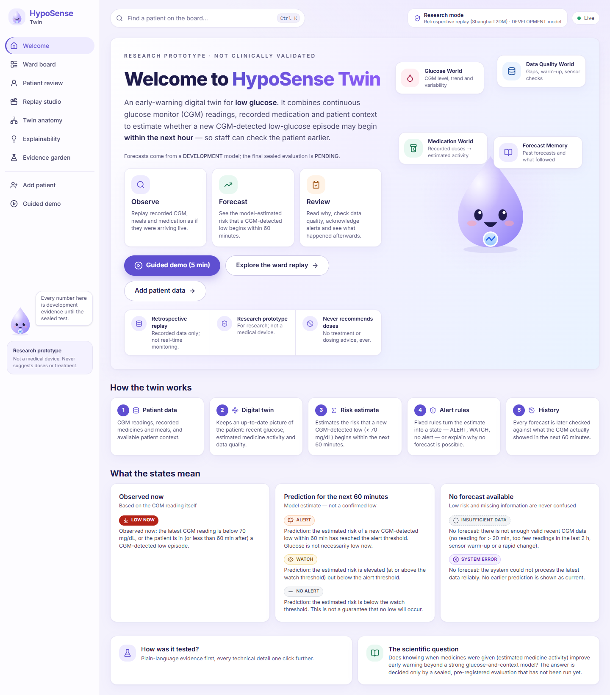
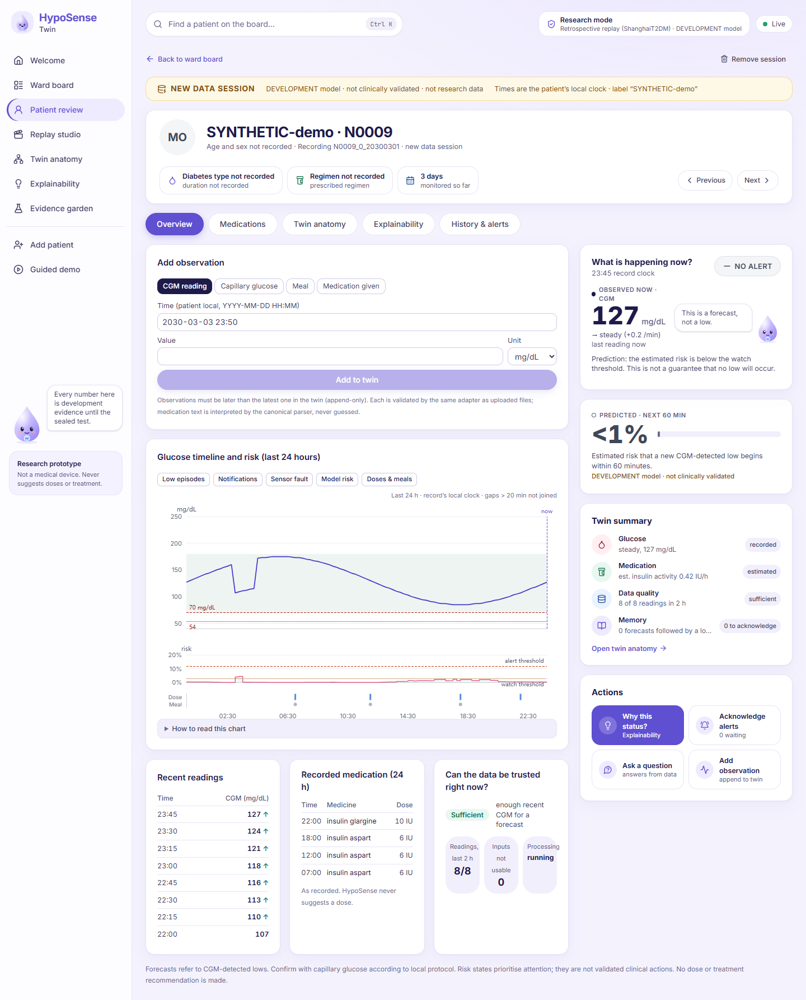
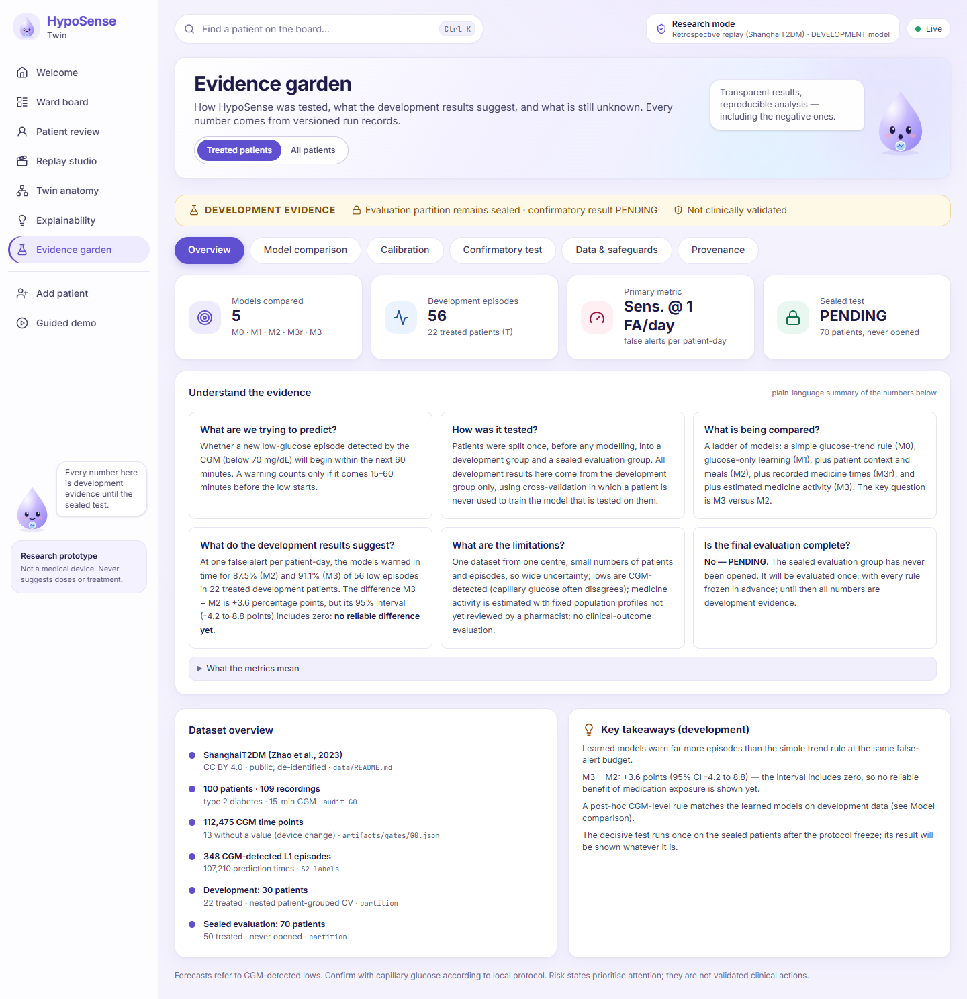
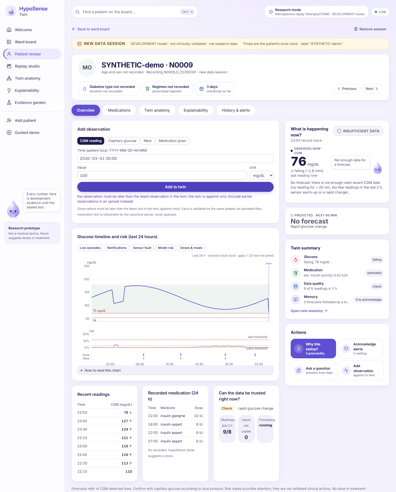

# HypoSense Twin

**An exposure-aware patient-state digital twin that forecasts CGM-detected low-glucose episodes
within the next 60 minutes, for adults with type 2 diabetes treated with insulin or insulin
secretagogues.**

> **Research and decision-support prototype.** Not a medical device and not clinically
> validated. It never recommends, adjusts or simulates doses or treatment. The only supported
> action is human review and capillary glucose confirmation. All results shown here are
> **development** results. The pre-registered confirmatory evaluation is **PENDING** (see
> [Current status](#16-current-status)).



---

## Contents

1. [Introduction](#1-introduction)
2. [Motivation](#2-motivation)
3. [Our solution](#3-our-solution)
4. [Key features](#4-key-features)
5. [Architecture](#5-architecture)
6. [Technology stack](#6-technology-stack)
7. [Installation](#7-installation)
8. [Quick start](#8-quick-start)
9. [Using the application](#9-using-the-application)
10. [Screenshots](#10-screenshots)
11. [Scientific methodology](#11-scientific-methodology)
12. [Results](#12-results)
13. [Reproducibility](#13-reproducibility)
14. [Testing](#14-testing)
15. [Project structure](#15-project-structure)
16. [Current status](#16-current-status)
17. [Known limitations](#17-known-limitations)
18. [References and acknowledgements](#18-references-and-acknowledgements)
19. [License](#19-license)
20. [Demo and submission materials](#20-demo-and-submission-materials)

---

## 1. Introduction

HypoSense Twin keeps an up-to-date **digital twin** of each patient, built from:
- continuous glucose monitor (CGM) readings;
- recorded medication (insulin, sulfonylureas, glinides and other agents);
- meals and patient context.

At every new CGM reading it estimates the risk that a **new CGM-detected Level 1 low (< 70
mg/dL) begins within the next 60 minutes**, with at least 15 minutes of warning. Fixed,
deterministic rules then turn that estimate into a status a ward team can act on: **ALERT**,
**WATCH**, **NO ALERT**, **LOW NOW** (an observed low), or an explicit "no forecast" state when
the data are insufficient.

The project is also an experiment with one pre-registered question: **does explicitly modelling
how long recorded medicines remain active (medication exposure) improve early warning beyond a
strong CGM-plus-context model?**

## 2. Motivation

- Low glucose (hypoglycaemia) is a common and serious complication of insulin and sulfonylurea
  therapy.
- In hospital, glucose is often checked on a timetable, so an episode can begin between checks.
- CGM shows where glucose *is*. Insulin and secretagogues keep acting for hours after they are
  given, so glucose history alone may not show everything that drives the next hour.
- HypoSense asks whether a model that also knows when and how much medicine was recorded can warn
  earlier, at the same false-alert burden.
- We make no claim about clinical impact. The confirmatory test has not been run.

## 3. Our solution

An **exposure-aware digital twin**, updated causally at every event:

| Layer | What it does |
|---|---|
| Patient data | CGM, capillary glucose (display only), meals, medication entries, static context (age, sex, BMI, HbA1c, eGFR, C-peptide, prescribed regimen) |
| Validation | Every file and entry is parsed by one canonical adapter: units, timestamps, duplicates, quality flags. Nothing is silently dropped |
| Patient State Engine | Per-patient state: CGM history and data quality, medication exposure, a forecast/outcome ledger |
| Medication exposure | Recorded doses become estimated activity curves via documented, label-sourced pharmacological kernels |
| Causal features | 100 features (M3) computed only from information available at or before the prediction time (bitwise truncation-equality tested) |
| Model + calibration | LightGBM classifier with a floored isotonic calibrator |
| Deterministic policy | ALERT / WATCH / NO ALERT / LOW NOW / INSUFFICIENT DATA / SYSTEM ERROR, with a 60-min notification cooldown. It never confuses "low risk" with "no information" |
| Interface | Ward board, patient twin, evidence view, new-patient intake |

Replay feeds recorded data through this same live pipeline in time order. It demonstrates the
system on historical data and is **not** real-time clinical monitoring.

## 4. Key features

| Feature | Description |
|---|---|
| **Welcome** | What HypoSense is, the four parts of the twin, how it works (5 steps), what each status means, where to start |
| **Guided demo** | An 8-step tour that drives the real replay. It fast-forwards to the first alert in replay order and then shows what actually happened, including false alerts |
| **Ward board** | Who needs attention now: state tiles and filters; per patient the latest glucose, 2-hour sparkline and change, risk for the next 60 min, status with a plain reason, data freshness, unacknowledged alerts; plus "glucose now" across patients, twin insights (counts) and recent events |
| **Replay studio** | Choose recordings and play, pause, step, seek or speed up the deterministic replay |
| **Patient review** | Profile from recorded context; tabs Overview · Medications · Twin anatomy · Explainability · History & alerts; a status rail that separates **observed now** from **predicted · next 60 min**, a twin summary and actions |
| **Twin anatomy** | The four state blocks of the twin (Glucose, Medication, Data Quality, Memory) with the values the model actually sees |
| **Glucose timeline** | Observed CGM, low episodes, notifications, the model's risk with thresholds, recorded doses and meals |
| **Medication exposure** | Recorded doses (bars) vs model-estimated activity (curves). The curves are estimates, never measured blood levels |
| **Explainability** | "Why is the twin worried?": the plain reason, cards for the information groups pushing the estimate up (grouped TreeSHAP; associations, not causes), all-group contribution chart, key values, technical detail on demand |
| **Forecast/outcome history** | Every forecast is later checked against what the CGM showed in the next 60 minutes; earlier forecasts are never rewritten |
| **Alert acknowledgement** | Four fixed reasons, written to an audit log |
| **Evidence garden** | Tabs: Overview (plain-language summary, KPIs), Model comparison (ladder, operating curves, paired CIs), Calibration, Confirmatory test (PENDING), Data & safeguards, Provenance; dataset overview and key takeaways |
| **Add patient** | Upload a CSV/XLSX recording or start an empty patient; 5-step flow |
| **Clarification questions** | Deterministic and asked only when the data need them (column meaning, glucose unit, clock / UTC offset, pump insulin, unreadable medication entries). Each says why it is asked and what happens if unanswered. Nothing is guessed |
| **Manual observations** | Append CGM, capillary glucose, meals and medication to a live twin, strictly in time order |
| **Ask about this patient** | 9 fixed questions (why this status, why (no) forecast, are readings current, what changed, after the last alert, medicines, warnings, what is missing, evidence), answered only from recorded state. No chatbot and no LLM |
| **Replay** | Deterministic multi-patient replay: play, pause, speed, step, seek, reset. Identical decision logs on every run |

## 5. Architecture

**Runtime (live and replay use the same path):**

```mermaid
flowchart LR
  A["Data input<br/>replay of recorded files · CSV/XLSX upload · manual entry"] --> B["Validation and canonical parser<br/>data.loader · intake"]
  B --> C["Patient State Engine<br/>CGM · data quality · ledger"]
  B --> D["Medication exposure<br/>dictionary + kernels"]
  D --> C
  C --> E["Causal features<br/>time-valid, 100 for M3"]
  E --> F["Model<br/>LightGBM"]
  F --> G["Calibration<br/>floored isotonic"]
  G --> H["Deterministic policy<br/>ALERT · WATCH · NO ALERT · LOW NOW · INSUFFICIENT DATA"]
  H --> I["FastAPI + SSE<br/>hyposense serve"]
  I --> J["Next.js frontend<br/>Welcome · Ward · Patient · Replay · Evidence · Add patient"]
```



**Scientific pipeline (separate from the runtime):**

```mermaid
flowchart LR
  P["Official data<br/>SHA-256 manifest"] --> Q["Patient-level partition<br/>T 30 · sealed E 70"]
  Q --> R["Development on T<br/>nested grouped CV · ladder M0 to M3"]
  R --> S["Freeze candidate<br/>built twice, identical hash"]
  S --> T["Protocol freeze<br/>hyposense freeze, fails closed"]
  T -->|only after freeze| U["Confirmatory run on E, once<br/>hyposense confirm"]
  U --> V["Model-selection rule<br/>final model"]
  V --> W["Reports and model card<br/>hyposense report"]
```



Details: [docs/ARCHITECTURE.md](docs/ARCHITECTURE.md) and [docs/FRONTEND.md](docs/FRONTEND.md).

## 6. Technology stack

These are the versions in the lock files and in the verified development environment.

| Area | Technology |
|---|---|
| Language / runtime | Python 3.11 (`requires-python >=3.11,<3.12`), Node.js 24 |
| Package management | [uv](https://docs.astral.sh/uv/) 0.10 (`uv.lock`), npm (`frontend/package-lock.json`) |
| ML / data | LightGBM 4.7, scikit-learn 1.9, Optuna 5.0 (tuning on T), SHAP (attribution), pandas 3.0, NumPy 2.4, SciPy, PyArrow, openpyxl / xlrd |
| Backend | FastAPI 0.143, Uvicorn 0.54, Pydantic 2.14, server-sent events |
| Frontend | Next.js 16.3 (static export served by FastAPI), React 19.3, TanStack Query 5, ECharts 6.1, Tailwind CSS 4.3, Radix UI, lucide-react, TypeScript 5.9 |
| Testing | pytest, Hypothesis, Vitest 5, Testing Library, Playwright (Microsoft Edge), axe-core |
| Quality | ruff, mypy `--strict`, `tsc` strict |

## 7. Installation

Prerequisites:
- Python 3.11;
- [uv](https://docs.astral.sh/uv/getting-started/installation/);
- Node.js ≥ 20 with npm;
- about 1 GB of disk space;
- internet access for the one-time dataset download.

The steps below were verified on **Windows 11** (Git Bash). The commands are the same in
PowerShell, macOS and Linux, but macOS and Linux have **not** been tested.

```bash
git clone <this repository>
cd HypoSense
uv sync                                   # Python environment from uv.lock
cd frontend && npm ci && npm run build && cd ..   # static frontend -> frontend/out
uv run hyposense data fetch               # official ShanghaiT2DM v5 from figshare (hash-verified)
uv run hyposense data extract             # allow-listed extraction to data/raw/ShanghaiT2DM
uv run hyposense data manifest            # verify every file against the committed manifest
```

The patient data are **not** in this repository. They are downloaded from the official figshare
record and verified against `data/MANIFEST.json` (see [data/README.md](data/README.md)).

## 8. Quick start

```bash
uv run hyposense serve                    # http://127.0.0.1:8000
uv run hyposense serve --port 8765        # custom port
```

Open **http://127.0.0.1:8000** (or your port) in a browser. Stop the server with `Ctrl+C`.

- The server verifies the committed DEVELOPMENT model artefact
  (`artifacts/models/M3-candidate-*`) and refuses to start on any mismatch.
- It loads only the tuning-partition (T) recordings; the sealed evaluation patients are never
  offered.
- Everything runs offline on the local machine. This is a local address, not a public deployment.

## 9. Using the application

**Guided demo (recommended first, about 5 minutes).** Open *Guided demo* → *Start the guided
demo*. The guide stays in the corner (it can be minimised) as you move between pages:
1. Start a replay of 8 recorded patients.
2. Advance 2 hours.
3. Fast-forward to the first real alert.
4. Read *Why is HypoSense showing this?*
5. Compare recorded vs estimated medicine.
6. Advance 75 minutes and see what happened. In the default replay, the first alert was **not**
   followed by a low (a false alert), and the demo says so.
7. Open the evidence.

**Historical replay.** *Replay studio* or *Ward board* → *Start replay of 8 recorded patients* (or choose others).
Use Play/Pause, speed, *Next event*, *+1 hour* and the position slider. Hover any status for its
meaning, and click a row to open the patient.

**Reviewing a prediction.** On a patient page, the status rail shows **Observed now** (the
latest CGM) separately from **Predicted · next 60 min** (the model's estimated risk, marked
DEVELOPMENT). The *Explainability* tab gives the reason and the associated information, with
*Technical detail* for the probability, thresholds and reason codes. *Twin anatomy* shows the
four state blocks.

**Adding a patient.** *Add patient* → optional pseudonymous label → *Choose file…* (CSV/XLSX
with a header row: date/time, CGM, optional capillary glucose, meals, medication) or *Start new
patient*. A synthetic example:
[docs/screenshots/intake/SYNTHETIC_recording.csv](docs/screenshots/intake/SYNTHETIC_recording.csv).

**Answering clarification questions.** Each question shows *Why we ask* and *If you can't
answer*. Required questions block creation until answered; optional ones keep the data as
recorded. *Create patient twin* becomes available when the draft is ready.

**Appending observations.** On a new-data patient, use *Add observation* (CGM, capillary
glucose, meal, medication given). Observations must be later than the latest one; the twin is
append-only. *Remove session* deletes the session and its log.

**Asking about the patient.** On the *Explainability* tab, pick one of the fixed questions in
*Ask about this patient*.

**Exploring the evidence.** *Evidence* → *Understand the evidence* (plain language), then
*Technical evidence*.

More detail: [docs/INTAKE.md](docs/INTAKE.md) and [docs/UX_REVIEW.md](docs/UX_REVIEW.md).

## 10. Screenshots

All screenshots in this repository show either SYNTHETIC data or aggregate statistics.

| Add patient: clarification questions | New-data patient twin (SYNTHETIC) |
|---|---|
|  |  |

| Evidence (development, aggregate) | Out-of-order observation refused |
|---|---|
|  |  |

## 11. Scientific methodology

**Target.**
- The event is the onset of a CGM-detected Level 1 episode (< 70 mg/dL, run rules in
  [docs/protocol/ANALYSIS_PLAN.md](docs/protocol/ANALYSIS_PLAN.md)).
- A warning counts if it is issued 15–60 minutes before onset.
- The false-alert budget is 1.0 false alert per patient-day.

**Model ladder.** Each step adds one kind of information:

| Model | Inputs |
|---|---|
| M0 | Deterministic CGM trend projection (no learning) |
| M1 | Learned CGM features: level, trend, variability, time (38 features) |
| M2 | M1 + static context + meal timing (72) |
| M3r | M2 + raw medication timing (95) |
| M3 | M2 + medication **exposure** state from pharmacological kernels (100). This is the canonical candidate |

M3_compact was a development ablation; it showed no robust advantage over full M3.

**Primary comparison.**
- Sensitivity at 1 FA/day of **M3 vs M2** in treated patients of the sealed evaluation
  partition.
- H1 is supported only if the lower bound of the paired 95% patient-cluster bootstrap interval
  (2,000 resamples, seed 2027) of Δ = M3 − M2 is above 0.

**Key safeguards.**
- **Patient-level separation:** the patient partition was fixed before modelling, and E is
  refused by the loader until a verified freeze exists.
- **Causal features:** features are identical whether computed on the full record or on the
  record truncated at the prediction time.
- **Nested patient-grouped cross-validation:** tuning, calibration and thresholds use training
  patients only.
- **Calibration:** maps raw scores to probabilities, fitted on inner out-of-fold predictions.
- **Fixed rules:** the model and the alert policy are separate modules.
- **Sensitivity:** the fraction of eligible episodes that received a notification in the warning
  window.
- **False alert:** a notification not followed by a qualifying onset.

Full protocol:
- [docs/protocol/ANALYSIS_PLAN.md](docs/protocol/ANALYSIS_PLAN.md)
- [docs/FEATURE_DICTIONARY.md](docs/FEATURE_DICTIONARY.md)
- [docs/medication/PARAMETER_SOURCES.md](docs/medication/PARAMETER_SOURCES.md)

## 12. Results

**CONFIRMATORY RESULTS PENDING.** The sealed evaluation partition has not been opened.

**Development results** (tuning partition T only; 22 treated patients, 56 episodes; nested
patient-grouped CV). Source: run `T-AGG-dev-s6-20261018T144427Z` in `experiments/runs/`.
Hyperparameters, calibration and thresholds were chosen on T, so these numbers are optimistic
and are **not** an answer to H1.

| Model | Sensitivity @ 1 FA/day | 95% CI |
|---|---|---|
| M0 | 62.6 % | 49.1 – 83.7 % |
| M1 | 85.7 % | 71.9 – 100 % |
| M2 | 87.5 % | 78.1 – 100 % |
| M3r | 92.9 % | 80.4 – 100 % |
| M3 | 91.1 % | 78.8 – 100 % |

- **M3 − M2 = +3.6 points (95% CI −4.2 to +8.8):** no reliable difference on development data.
- Learned models vs the trend rule (M1 − M0): +23.1 points (9.4 to 43.7).

A post-hoc, non-pre-specified CGM-level rule (alert when CGM < 81 mg/dL) reaches 91.1 % on T. It
is shown as a reference, not as a comparator.

## 13. Reproducibility

| Item | Where |
|---|---|
| Data source | ShanghaiT2DM v5, official figshare copy, SHA-256 manifest `data/MANIFEST.json` |
| Partition | `configs/partition.csv` (pinned hash; 30 T / 70 E patients) |
| Feature spec | `artifacts/features/feature_spec.json` (v1.0.1) |
| Medication dictionary and kernels | `configs/drug_dictionary.csv`, `configs/pharma.yaml` |
| Configuration and seeds | `configs/default.yaml` (model seed 2026, CV seed 2026, bootstrap seed 2027) |
| Model artefact | `artifacts/models/M3-candidate-*` (manifest-hashed; rebuilt with identical results, `c0cbe721…`) |
| Run records | `experiments/runs/<run-id>/results.json` (git commit, data/config hashes, seeds, results hash) |
| Decisions | [docs/DECISION_LOG.md](docs/DECISION_LOG.md), [docs/EXPERIMENT_LOG.md](docs/EXPERIMENT_LOG.md) |

Commands (development, T only):

```bash
uv run hyposense audit run && uv run hyposense audit events && uv run hyposense audit medication
uv run hyposense audit features           # truncation equality, parity, perturbation
uv run hyposense dev s6                   # development ladder on T
uv run hyposense dev candidate            # freeze candidate (run twice: identical hash)
uv run hyposense confirm --rehearsal      # the confirmatory code, on T only (never evidence)
uv run hyposense freeze                   # protocol freeze; fails closed
```

Replay is deterministic: the same selection gives the same decision-log hash.

**E access.**
- Only `hyposense confirm --freeze artifacts/freeze/FREEZE.json` can open the sealed partition,
  and only after the freeze record verifies: code tree, configs, data, partition, plan, locks and
  model.
- It runs once.
- New-data uploads are never part of any partition.

## 14. Testing

```bash
uv run pytest -q                          # full Python suite (unit, leakage, regression, integration, E2E)
uv run pytest -q tests/leakage            # leakage and import-boundary guards
uv run pytest -q tests/integration        # real T recordings with synthetic models; intake; replay API
uv run pytest -q tests/e2e                # browser E2E (needs the frontend build and Microsoft Edge)
uv run ruff check src tests && uv run mypy src
cd frontend && npx vitest run && npx tsc --noEmit && npm audit
```

The browser E2E tests drive Microsoft Edge through Playwright and skip if Edge or the build is
unavailable. Latest results are in [Current status](#16-current-status).

## 15. Project structure

```
HypoSense/
├── src/hyposense/        Python package
│   ├── data/             official data loading, manifest, partition, sealed-E guards
│   ├── labels/           CGM episode labelling
│   ├── medication/       drug dictionary, parser, exposure kernels
│   ├── state/            Patient State Engine (events, CGM, quality, medication, ledger)
│   ├── features/         causal feature builder and specification
│   ├── models/           LightGBM, M0, model artefacts
│   ├── calibration/      calibrators
│   ├── policy/           deterministic alert policy and display texts
│   ├── replay/           twin runner and deterministic replay session
│   ├── intake/           new-data upload, clarification questions, live sessions
│   ├── api/              FastAPI service (REST + SSE), held-out replay
│   ├── evaluation/       metrics, bootstrap, S6 development, S9 confirmatory runner
│   ├── reporting/        results view and report / model-card generator
│   ├── audit/            data, event, medication and feature audits
│   ├── freeze.py         protocol freeze and verification
│   └── cli.py            `hyposense` command line
├── frontend/             Next.js app (src/app: overview, demo, ward, patient, intake, evidence)
├── tests/                unit, leakage, regression, integration, reproducibility, e2e
├── configs/              default.yaml, pharma.yaml, drug_dictionary.csv, partition.csv
├── artifacts/            model artefacts, gates, feature spec, population (aggregate only)
├── experiments/runs/     run records (aggregate results with provenance)
├── data/                 manifests only; patient data are downloaded, never committed
├── docs/                 architecture, protocol, decisions, intake, UX review, submission
└── scripts/              UI audit, screenshots, walkthroughs, OpenAPI export
```

## 16. Current status

| Area | Status |
|---|---|
| Data, labels, medication exposure, state engine, causal features | **Complete** (audited; leakage tests pass) |
| Model ladder, calibration, policy, replay, API | **Complete** (development) |
| Frontend (Welcome, Ward board, Patient review with Twin anatomy and Explainability, Replay studio, Evidence garden, Add patient, Guided demo) | **Complete**; WCAG 2 A/AA axe audit: 0 violations |
| New-patient intake, questions, live sessions, Ask | **Complete** (development sessions, never research data) |
| Confirmatory runner and report generator | **Built and rehearsed on T**; not run on E |
| Clinical-pharmacist review of medication kernels | **PENDING** ([docs/medication/PHARMACIST_REVIEW.md](docs/medication/PHARMACIST_REVIEW.md)) |
| Approval of confirmatory operational definitions (P-C11) | **PENDING** ([docs/protocol/P-C11_APPROVAL_MATRIX.md](docs/protocol/P-C11_APPROVAL_MATRIX.md)) |
| Protocol freeze | **BLOCKED** by the two human gates above. All technical checks pass |
| Confirmatory evaluation (H1) | **NOT RUN.** The sealed partition is unopened |
| Final model | **Not selected.** The development candidate is `M3-development-3271a3206765` |

Latest verification: see [docs/submission/TEST_REPORT.md](docs/submission/TEST_REPORT.md).

## 17. Known limitations

- **Status:** research prototype; not a medical device; not clinically validated. No clinical
  benefit is claimed.
- **Evidence:**
  - one public dataset from one centre (ShanghaiT2DM);
  - internal validation only;
  - small numbers (30 development and 70 evaluation patients), so intervals are wide and only
    large effects are detectable.
- **Labels:**
  - lows are **CGM-detected**, not independently confirmed;
  - CGM and capillary glucose often disagree around 70 mg/dL (gate G3b TRIGGERED).
- **Medication:**
  - exposure uses fixed population-level kernels, which a clinical pharmacist has not yet
    reviewed;
  - recorded dose times may not be exact administration times.
- **Insufficient data:**
  - with too little recent CGM there is no forecast (by design);
  - rapid changes and gaps suppress forecasts.
- **Generalisation:** unknown for other populations, sensors, settings and imported data.
- **New-data sessions:** use the development model, with no accuracy claim for uploaded data.
  Daylight-saving jumps within an upload are flagged, not corrected.

## 18. References and acknowledgements

- **Dataset:** Zhao Q, Zhu J, Shen X, Lin C, Zhang Y, Liang Y, Cao B, Li J, Liu X, Rao W, Wang C.
  *Chinese diabetes datasets for data-driven machine learning.* Scientific Data 10 (2023).
  doi:10.1038/s41597-023-01940-7.
  - Data: ShanghaiT1DM and ShanghaiT2DM, figshare collection doi:10.6084/m9.figshare.c.6310860.
  - Licence: **CC BY 4.0**. We thank the authors for making the data openly available.
- **Medication kernel parameters:** sourced from product labels, as listed in
  [docs/medication/PARAMETER_SOURCES.md](docs/medication/PARAMETER_SOURCES.md).
- **Specification:** [docs/HypoSense_Twin_v2_Blueprint.docx](docs/HypoSense_Twin_v2_Blueprint.docx).

## 19. License

- **Code:** `pyproject.toml` declares **MIT**. The `LICENSE` file (with the copyright-holder line)
  has **not been added yet**; this is pending the owner's decision. Until it is added, no licence
  grant should be assumed.
- **Data:** CC BY 4.0, attributed to the dataset authors (see above). The data are not
  redistributed here.

## 20. Demo and submission materials

| Material | Location |
|---|---|
| Submission package (deck, honesty card, model card, demo guide, test report) | [docs/submission/](docs/submission/README.md) |
| 5-minute judge demonstration script | [docs/UX_REVIEW.md](docs/UX_REVIEW.md) §5 |
| Architecture | [docs/ARCHITECTURE.md](docs/ARCHITECTURE.md) |
| Analysis plan and approval matrix | [docs/protocol/](docs/protocol/ANALYSIS_PLAN.md) |
| New-data intake guide | [docs/INTAKE.md](docs/INTAKE.md) |
| Project state | [docs/CURRENT_STATE.md](docs/CURRENT_STATE.md), [docs/NEXT_STEPS.md](docs/NEXT_STEPS.md) |
