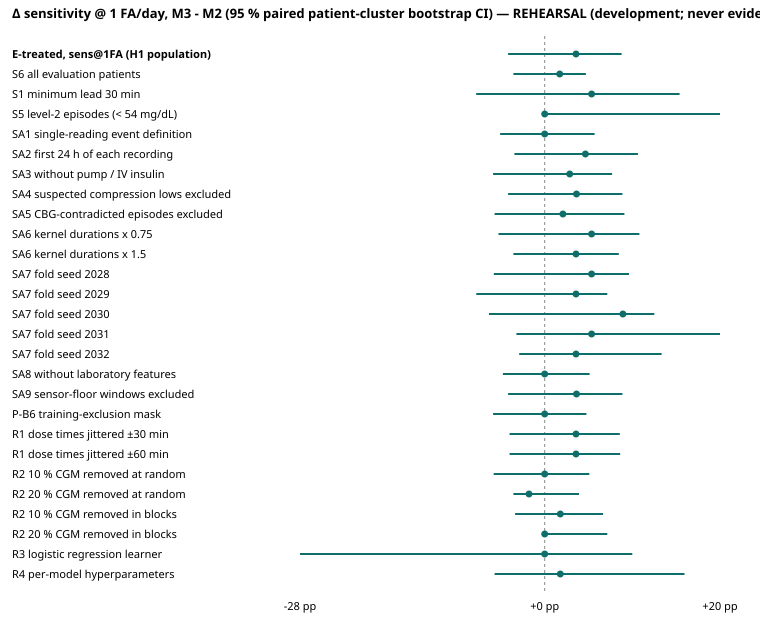
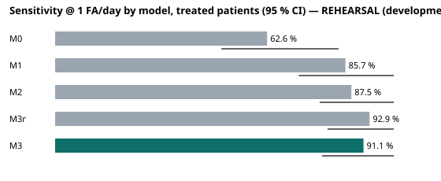

# Confirmatory results (S9)

> **Status: REHEARSAL (development; never evidence).** Generated from a T-only rehearsal of the confirmatory code. These are NOT confirmatory results and must not be cited as evidence.

- Run: `T-AGG-rehearsal-20261019T070224Z` · results SHA-256 `94532e83920d6273175db5b8bfb575e55b4cc02943da3b31a09d21e7ddf61f36`
- Freeze record: `—`
- Code commit: `94a724665f69d77f1c8569c4618b5bb2fa683a2e`
- Population: {"evaluation_patients": 30, "evaluation_treated": 22, "training_always": 0, "episodes_treated": 56, "readings": 33464}

## Primary endpoint (H1)

| Quantity | Value |
|---|---|
| M2 sens@1FA | 87.5 % |
| M3 sens@1FA | 91.1 % |
| Δ M3 - M2 | +3.6 pp |
| 95 % CI | -4.2 pp to +8.8 pp |
| Undefined resamples (G5) | 0 (pass) |
| **H1 supported** (lower bound > 0) | **NO** |

## Model selection (ANALYSIS_PLAN §6, applied mechanically)

Selected: **M3**

- H1 not supported; M3 higher sens@1FA and log-loss not worse -> M3

## Interpretation (Blueprint Table 20.4, mechanical)

- Δ point estimate > 0, CI includes 0; S3 favours M3
- M2 ≈ M1

## Model ladder (primary population)

| Model | sens@1FA | 95 % CI | Log-loss | Deployed sens | FA/day | Precision | Median lead |
|---|---|---|---|---|---|---|---|
| M0 | 62.6 % | 49.1 % to 83.7 % | — | — | — | — | — |
| M1 | 85.7 % | 71.9 % to 100.0 % | 0.0307 | 85.7 % | 1.00 | 15.8 % | 45.0 min |
| M2 | 87.5 % | 78.1 % to 100.0 % | 0.0311 | 85.7 % | 0.87 | 17.7 % | 37.5 min |
| M3r | 92.9 % | 80.4 % to 100.0 % | 0.0301 | 85.7 % | 0.91 | 17.1 % | 30.0 min |
| M3 | 91.1 % | 78.8 % to 100.0 % | 0.0302 | 89.3 % | 0.86 | 18.5 % | 30.0 min |

Deployed = fold-frozen τA applied to held-out patients (a different quantity from the sens@1FA operating curve).

## Paired contrasts (sens@1FA)

| Contrast | Δ | 95 % CI |
|---|---|---|
| C0_M1-M0 | +23.1 pp | +9.4 pp to +43.7 pp |
| C1_M2-M1 | +1.8 pp | -6.4 pp to +8.9 pp |
| C2a_M3r-M2 | +5.4 pp | -5.4 pp to +10.7 pp |
| C2b_M3-M3r | -1.8 pp | -8.6 pp to +5.7 pp |
| preview_M3-M2 | +3.6 pp | -4.2 pp to +8.8 pp |

S2 (FA/day at matched sensitivity, M3 - M2): -0.133 (95 % CI -0.318 to 0.290)

## Secondary, sensitivity and robustness analyses

| Group | Analysis | Patients | Episodes | M2 | M3 | Δ | 95 % CI |
|---|---|---|---|---|---|---|---|
| Primary | E-treated, sens@1FA (H1 population) | 22 | 56 | 87.5 % | 91.1 % | +3.6 pp | -4.2 pp to +8.8 pp |
| Secondary | S6 all evaluation patients | 30 | 117 | 83.8 % | 85.5 % | +1.7 pp | -3.6 pp to +4.7 pp |
| Secondary | S1 minimum lead 30 min | 22 | 56 | 66.1 % | 71.4 % | +5.4 pp | -7.8 pp to +15.4 pp |
| Secondary | S5 level-2 episodes (< 54 mg/dL) | 22 | 8 | 62.5 % | 62.5 % | +0.0 pp | +0.0 pp to +20.0 pp |
| Sensitivity | SA1 single-reading event definition | 22 | 73 | 87.7 % | 87.7 % | +0.0 pp | -5.1 pp to +5.7 pp |
| Sensitivity | SA2 first 24 h of each recording | 22 | 43 | 90.7 % | 95.3 % | +4.7 pp | -3.4 pp to +10.6 pp |
| Sensitivity | SA3 without pump / IV insulin | 10 | 35 | 85.7 % | 88.6 % | +2.9 pp | -5.9 pp to +7.7 pp |
| Sensitivity | SA4 suspected compression lows excluded | 22 | 55 | 87.3 % | 90.9 % | +3.6 pp | -4.2 pp to +8.9 pp |
| Sensitivity | SA5 CBG-contradicted episodes excluded | 22 | 48 | 87.5 % | 89.6 % | +2.1 pp | -5.7 pp to +9.1 pp |
| Sensitivity | SA6 kernel durations x 0.75 | 22 | 56 | 87.5 % | 92.9 % | +5.4 pp | -5.3 pp to +10.8 pp |
| Sensitivity | SA6 kernel durations x 1.5 | 22 | 56 | 87.5 % | 91.1 % | +3.6 pp | -3.6 pp to +8.5 pp |
| Sensitivity | SA7 fold seed 2028 | 22 | 56 | 83.9 % | 89.3 % | +5.4 pp | -5.8 pp to +9.6 pp |
| Sensitivity | SA7 fold seed 2029 | 22 | 56 | 87.5 % | 91.1 % | +3.6 pp | -7.8 pp to +7.1 pp |
| Sensitivity | SA7 fold seed 2030 | 22 | 56 | 78.6 % | 87.5 % | +8.9 pp | -6.4 pp to +12.5 pp |
| Sensitivity | SA7 fold seed 2031 | 22 | 56 | 83.9 % | 89.3 % | +5.4 pp | -3.2 pp to +20.0 pp |
| Sensitivity | SA7 fold seed 2032 | 22 | 56 | 87.5 % | 91.1 % | +3.6 pp | -2.9 pp to +13.3 pp |
| Sensitivity | SA8 without laboratory features | 22 | 56 | 92.9 % | 92.9 % | +0.0 pp | -4.8 pp to +5.1 pp |
| Sensitivity | SA9 sensor-floor windows excluded | 22 | 55 | 89.1 % | 92.7 % | +3.6 pp | -4.2 pp to +8.9 pp |
| Sensitivity | P-B6 training-exclusion mask | 22 | 56 | 89.3 % | 89.3 % | +0.0 pp | -5.9 pp to +4.8 pp |
| Robustness | R1 dose times jittered ±30 min | 22 | 56 | 87.5 % | 91.1 % | +3.6 pp | -4.0 pp to +8.6 pp |
| Robustness | R1 dose times jittered ±60 min | 22 | 56 | 87.5 % | 91.1 % | +3.6 pp | -4.0 pp to +8.6 pp |
| Robustness | R2 10 % CGM removed at random | 22 | 56 | 73.2 % | 73.2 % | +0.0 pp | -5.8 pp to +5.1 pp |
| Robustness | R2 20 % CGM removed at random | 22 | 56 | 50.0 % | 48.2 % | -1.8 pp | -3.6 pp to +3.9 pp |
| Robustness | R2 10 % CGM removed in blocks | 22 | 56 | 82.1 % | 83.9 % | +1.8 pp | -3.4 pp to +6.7 pp |
| Robustness | R2 20 % CGM removed in blocks | 22 | 56 | 71.4 % | 71.4 % | +0.0 pp | +0.0 pp to +7.1 pp |
| Robustness | R3 logistic regression learner | 22 | 56 | 30.4 % | 30.4 % | +0.0 pp | -27.9 pp to +10.0 pp |
| Robustness | R4 per-model hyperparameters | 22 | 56 | 89.3 % | 91.1 % | +1.8 pp | -5.7 pp to +15.9 pp |

R3 caveat (pre-registered, ANALYSIS_PLAN §5.7 item 26): the logistic-regression learner overfits patient-level prescription flags; a low R3 value is a property of that learner.

## Demo cases (ANALYSIS_PLAN §5.7 item 30, pre-specified selection)

Candidates: {"TP": 50, "FN": 6, "FP": 220}; seed 2026.

- TP: `2069_2_20210825` at ts 1630791780
- FN: `2040_0_20210729` at ts 1627785480
- FP: `2080_0_20210816` at ts 1629250500

